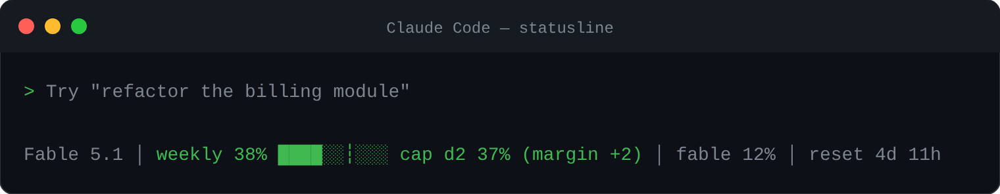
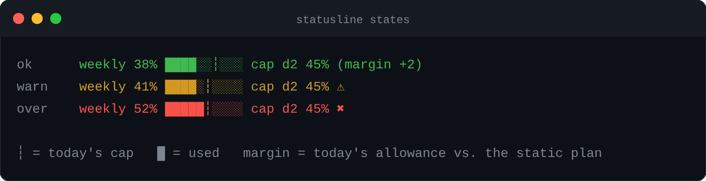
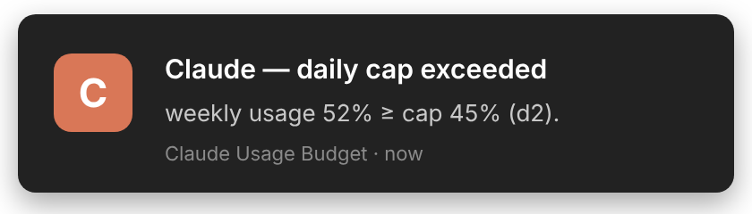
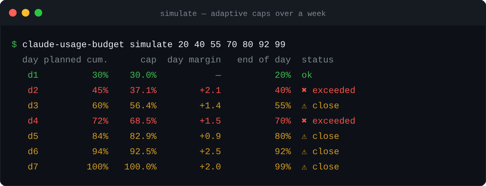

<div align="center">

# claude-usage-budget

**Pace your Claude weekly usage limit — daily caps, adaptive margins, desktop alerts.**

[](#)
[](#)
[](#)
[](LICENSE)



</div>

Anthropic removed the 5-hour limit on some plans. Great for long sessions — but now the
only guardrail is the **weekly** one, and it's easy to burn half of it on day one.

`claude-usage-budget` plugs into the Claude Code **statusline** and turns that single weekly
number into a daily plan you can actually follow.

## ✨ Features

- **One-line status** in Claude Code: weekly usage, today's cap, time to reset — green / yellow / red.
- **Daily caps** you choose (e.g. 30 % by end of day 1, 45 % by day 2…).
- **Adaptive margins** — what you don't spend today is spread over the remaining days (and overspending tightens them, optional).
- **Desktop notifications** the first time you cross a cap: Windows toast (native **or from WSL**), Linux `notify-send`, macOS.
- **Resets itself** when Claude's weekly window rolls over — nothing to schedule.
- Zero dependencies, Python ≥ 3.8, English or French UI.

<div align="center">

</div>

## 🚀 Quick start

**WSL · Linux · macOS**

```bash
git clone https://github.com/<your-user>/claude-usage-budget.git ~/claude-usage-budget
cd ~ && bash claude-usage-budget/install.sh
```

**Windows (PowerShell)**

```powershell
git clone https://github.com/<your-user>/claude-usage-budget.git "$env:USERPROFILE\claude-usage-budget"
powershell -ExecutionPolicy Bypass -File "$env:USERPROFILE\claude-usage-budget\install.ps1"
```

Restart Claude Code — the line appears at the bottom. That's it.

The installer sets up `pipx` (or `pip --user`), installs in editable mode, writes a default
config, adds the `statusLine` entry to `~/.claude/settings.json` (backup kept) and sends a
test notification. Re-run it any time; `git pull` alone is enough for code updates.

> **Install where Claude Code runs**: inside WSL if you use it in WSL, on Windows if you use
> it from PowerShell. Windows notifications work from both.

<div align="center">

</div>

## ⚙️ Set your daily caps

```bash
claude-usage-budget set ramp 30 45 60 72 84 94 100   # cumulative % by end of day 1…7
claude-usage-budget set warn_ratio 0.8               # ⚠ at 80 % of today's cap
claude-usage-budget set lang fr                      # French UI
claude-usage-budget edit                             # or open the JSON in VS Code / $EDITOR
```

Caps are **cumulative**: `60` on day 3 means "no more than 60 % of the week by the end of
day 3". Day 1 is the first day after your weekly reset.

### Adaptive margins

At the start of each day the tool snapshots your real usage and recomputes today's cap:

```
cap_today = used_at_start + (100 − used_at_start) × share_today / share_of_remaining_days
```

Allowed 30 % on day 1 but used 20 %? The 10 points are spread over the six remaining days,
proportionally — not dumped on day 2. The statusline shows the effect: `cap d2 37% (margin +2)`.
Set `"carry_overspend": false` if overspending should *not* shrink later days.

Preview a whole week before living it:

<div align="center">

</div>

<details>
<summary><b>All configuration keys</b> (<code>~/.claude/usage-budget.json</code>)</summary>

| Key | Default | Meaning |
|---|---|---|
| `mode` | `reset` | `reset` → day index from Claude's `resets_at`. `calendar` → keyed by weekday. |
| `ramp` | `[15,30,45,60,75,90,100]` | Cumulative caps for day 1…7 (`reset` mode). |
| `calendar` | mon→sun | Cumulative caps per weekday (`calendar` mode). |
| `week_starts` | `sat` | Weekday your window resets on (only used by `calendar` mode). |
| `redistribute` | `true` | Adaptive margins. |
| `carry_overspend` | `true` | Overspending also tightens later days. |
| `warn_ratio` | `0.9` | ⚠ when usage ≥ ratio × today's cap. |
| `global_alerts` | `[50,75,90,100]` | One-shot notifications on the raw weekly %. |
| `primary_bucket` | `seven_day` | Rate-limit bucket that drives the budget; other `seven_day_*` buckets are shown dimmed. |
| `notify` | `true` | Desktop notifications on/off. |
| `show_model` / `show_reset` / `show_five_hour` | `true` | Extra segments in the line. |
| `lang` | `en` | `en` or `fr`. |
| `label` | `""` | Word before the percentage (`weekly` / `hebdo` by default). |
| `colors` | `true` | ANSI colors (`NO_COLOR` is honoured). |

Environment overrides: `CLAUDE_USAGE_BUDGET_CONFIG`, `CLAUDE_USAGE_BUDGET_STATE`, `CLAUDE_CONFIG_DIR`.

</details>

<details>
<summary><b>All commands</b></summary>

```bash
claude-usage-budget statusline                 # used by Claude Code (JSON on stdin)
claude-usage-budget set <key> <values…>        # change one config key
claude-usage-budget edit [--path]              # open the config (VS Code / $EDITOR)
claude-usage-budget simulate 20 40 55 70 80 92 99   # replay a week
claude-usage-budget check --used 42 --reset-in-hours 60 [--dry-run]
claude-usage-budget test-notify                # check the notification backend
claude-usage-budget show                       # effective config + alert state
claude-usage-budget reset-state                # forget alerts fired this week
claude-usage-budget init [--lang fr] [--force] # write default config + settings snippet
```

</details>

<details>
<summary><b>Manual setup</b> (without the installer)</summary>

```bash
pip install git+https://github.com/<your-user>/claude-usage-budget
claude-usage-budget init
```

Then add to `~/.claude/settings.json` (use the absolute path `init` prints):

```json
{
  "statusLine": { "type": "command", "command": "/path/to/claude-usage-budget statusline", "padding": 0 }
}
```

</details>

<details>
<summary><b>How it works & limitations</b></summary>

Claude Code pipes a JSON document to the statusline command on every refresh, including:

```json
{
  "model": { "display_name": "…" },
  "rate_limits": {
    "five_hour": { "used_percentage": 12, "resets_at": "…" },
    "seven_day": { "used_percentage": 38, "resets_at": "2026-11-07T08:00:00Z" }
  }
}
```

The tool reads `seven_day`, works out which day of the window you're in from `resets_at`,
compares with your cap, prints, and notifies once per threshold per week
(state in `~/.claude/usage-budget-state.json`).

- The percentage is **account-wide** (web + mobile + Claude Code) but only refreshed while
  a Claude Code session is running — no session, no alert.
- Payload field names may evolve; the parser is defensive and degrades to `weekly n/a`
  rather than crashing.
- Windows toasts use `powershell.exe -EncodedCommand` with PowerShell's own AppUserModelId
  (no registration needed). Nothing showing? Check *Focus Assist / Do Not Disturb* and run
  `claude-usage-budget test-notify`.

</details>

## 🧹 Uninstall

```bash
bash ~/claude-usage-budget/uninstall.sh          # WSL / Linux / macOS
powershell -File "$env:USERPROFILE\claude-usage-budget\uninstall.ps1"   # Windows
```

Removes the package and the `statusLine` entry; your config file is kept.

## 📄 License

MIT — see [LICENSE](LICENSE).
